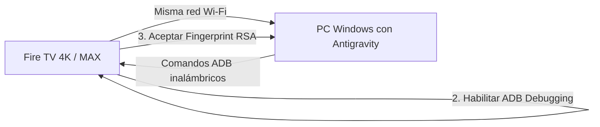

# Plan de Conexión y Optimización Integral de Fire TV (4K MAX & 4K) con Antigravity

Este plan técnico describe la arquitectura, requisitos previos del dispositivo, configuración de herramientas y el procedimiento paso a paso para conectar **Antigravity** con tu **Amazon Fire TV 4K MAX** (y compatible con **Fire TV 4K**), eliminar el rastreo y la publicidad innecesaria de Amazon, acelerar el rendimiento del hardware y habilitar la instalación directa de aplicaciones (APKs) por red local sin depender de la aplicación *Downloader*.

---

## 1. Información y Requisitos Previos del Dispositivo

Para que Antigravity pueda comunicarse con el Fire TV, necesitamos preparar el dispositivo en su red local:



### Paso A: Obtener la Dirección IP del Fire TV
1. En tu Fire TV, ve a **Configuración (engranaje)** > **Mi Fire TV** (o *Dispositivo y software*).
2. Selecciona **Acerca de** > **Red**.
3. Anota la **Dirección IP** (ejemplo: `192.168.1.150`).
4. *Requisito:* Tu PC con Antigravity y tu Fire TV deben estar conectados a la **misma red Wi-Fi/LAN** (y que el router no tenga activo "Aislamiento de AP/Clientes").

### Paso B: Activar Menú de Opciones para Desarrolladores
*(En versiones recientes de Fire OS 7 y 8, Amazon ocultó este menú por defecto)*:
1. Ve a **Configuración** > **Mi Fire TV** > **Acerca de**.
2. Selecciona el nombre del dispositivo (ej. *Fire TV Stick 4K Max*) y **presiona el botón central del mando 7 veces consecutivas**.
3. Verás una notificación abajo: *"Ya eres desarrollador"*.

### Paso C: Habilitar Depuración ADB y Orígenes Desconocidos
1. Regresa a **Mi Fire TV** y ahora verás **Opciones para desarrolladores**.
2. Entra y activa:
   - **Depuración ADB**: `ACTIVADO` (ON).
   - **Instalar apps desconocidas** (o *Apps de orígenes desconocidos*): `ACTIVADO` (ON).

---

## 2. Decisiones de Arquitectura y Seguridad

> [!IMPORTANT]
> **Estrategia No Destructiva (Debloat Seguro):**
> Nunca utilizaremos `pm uninstall` a ciegas, ya que en Fire OS puede romper dependencias del sistema operativo o causar reinicios en bucle (bootloops). En su lugar, utilizaremos:
> ```bash
> pm disable-user --user 0 <nombre_del_paquete>
> ```
> Esta orden congela el paquete a nivel de usuario, liberando memoria RAM, CPU y deteniendo rastreadores, pero se mantiene intacto en la partición del sistema y puede ser reactivado en cualquier instante con:
> ```bash
> pm enable <nombre_del_paquete>
> ```

> [!CAUTION]
> **Componentes Críticos que NO se deben apagar:**
> No desactivar `com.amazon.tv.launcher` a menos que previamente se haya instalado y configurado un launcher alternativo (como *Projectivy Launcher*) con mapeo de botón Home; de lo contrario, la pantalla quedaría en negro al presionar Home.

---

## 3. Cambios Propuestos en el Proyecto (`amazon-firetv`)

Estructuraremos el repositorio local en `c:\xampp\htdocs\amazon-firetv` para que sea una suite automatizada y reutilizable:

```
amazon-firetv/
├── tools/
│   └── platform-tools/       # Binario portable de ADB (adb.exe) para Windows
├── scripts/
│   ├── 01_connect.ps1        # Script interactivo de conexión y emparejamiento ADB
│   ├── 02_audit_packages.ps1 # Auditoría y volcado de paquetes activos en el Fire TV
│   ├── 03_debloat_safe.ps1   # Desactivación segura de telemetría y publicidad
│   ├── 04_dns_adblock.ps1    # Configuración de Private DNS (AdGuard / NextDNS)
│   ├── 05_install_apk.ps1    # Sideloading masivo/directo de APKs sin Downloader
│   ├── 06_optimize_ui.ps1    # Reducción de animaciones (0.5x) para máxima fluidez
│   └── 99_restore_all.ps1    # Script de rescate/reversión instantánea (Undo)
├── apks/                     # Carpeta local para colocar APKs a instalar directamente
├── logs/                     # Respaldos de listas de paquetes antes y después
└── README.md                 # Documentación de uso rápido
```

---

## 4. Fases de Ejecución

### Fase 1: Entorno ADB Portable
- Descargar y descomprimir de forma transparente `platform-tools` oficial de Android para Windows dentro de `tools/platform-tools/` (o configurarlo en la sesión de terminal), eliminando cualquier error de `adb not found`.

### Fase 2: Conexión y Autorización RSA
- Ejecutar conexión remota:
  ```powershell
  .\tools\platform-tools\adb.exe connect <IP_FIRETV>:5555
  ```
- En la pantalla de tu televisor aparecerá una ventana emergente: **"¿Permitir depuración USB/ADB?"**.
- Deberás marcar la casilla **"Permitir siempre desde este equipo"** y pulsar **Aceptar**.

### Fase 3: Auditoría y Respaldo de Paquetes
- Exportar lista de todos los paquetes instalados a `logs/packages_original.txt`:
  ```powershell
  adb shell pm list packages -f
  ```
- Generar automáticamente el script de restauración inversa con todos los paquetes detectados.

### Fase 4: Eliminación de Telemetría y Publicidad Innecesaria
Desactivar servicios secundarios devoradores de recursos y rastreadores:
- Telemetría y métricas de comportamiento de Amazon:
  - `com.amazon.device.logmanager`
  - `com.amazon.device.messaging`
  - `com.amazon.client.metrics`
  - `com.amazon.usage.collection`
  - `com.amazon.tv.forcedotaupdater.v2` (opcional: previene actualizaciones forzadas no deseadas)
- Anuncios y pantallas de compra integradas innecesarias:
  - `com.amazon.advertising.firetv`
  - `com.amazon.visualsearch`
  - `com.amazon.fv`
  - Redundancias de tienda/noticias patrocinadas en segundo plano.

### Fase 5: Configuración de DNS Privado Antianuncios
Evitar que aplicaciones de streaming y el sistema carguen banners y dominios de publicidad sin necesidad de VPN:
```powershell
adb shell settings put global private_dns_mode hostname
adb shell settings put global private_dns_specifier dns.adguard-dns.com
```

### Fase 6: Optimización de Rendimiento y Respuesta de Pantalla
Ajustar las escalas de animación del sistema Android para que la interfaz responda instantáneamente al mando a distancia:
```powershell
adb shell settings put global window_animation_scale 0.5
adb shell settings put global transition_animation_scale 0.5
adb shell settings put global animator_duration_scale 0.5
```

### Fase 7: Instalación Directa de Aplicaciones (Sideloading sin Downloader)
- Crear el comando/script para arrastrar archivos `.apk` en la carpeta `apks/` e instalarlos automáticamente por red:
  ```powershell
  adb install -r -d "apks/ejemplo.apk"
  ```
- Posibilidad de instalar un gestor de archivos ligero o un launcher limpio si el usuario lo desea.

---

## 5. Plan de Verificación

### Verificación Automatizada
1. `adb devices`: Comprobar estado `device` (no `unauthorized` ni `offline`).
2. `adb shell settings get global private_dns_specifier`: Verificar que el DNS antianuncios esté activo.
3. `adb shell pm list packages -d`: Verificar que los paquetes bloatware están en lista de deshabilitados.

### Verificación Manual en el Televisor
1. **Fluidez del sistema:** Navegación por el menú con el mando mucho más rápida.
2. **Publicidad y carruseles:** Comprobar reducción de publicidad invasiva y consumo de red en segundo plano.
3. **Instalación de Apps:** Comprobar que una app enviada por ADB aparece lista para usarse en la cuadrícula de aplicaciones sin haber abierto Downloader ni navegadores lentos.
4. **Seguridad y reversibilidad:** Probar el script de reversión para garantizar que todo vuelve a su estado de fábrica en caso de requerirlo.

---

## Preguntas para el Usuario

1. **¿Tienes a mano la Dirección IP de tu Fire TV 4K MAX?** (si ya la tienes, compártela para probar la conexión directamente).
2. **¿Deseas mantener la pantalla de inicio original de Amazon limpia de telemetría y anuncios, o te gustaría además evaluar instalar un launcher minimalista ultra-rápido (como Projectivy Launcher)?**
3. **¿Tienes aplicaciones APK específicas que desees instalar en este momento?**
