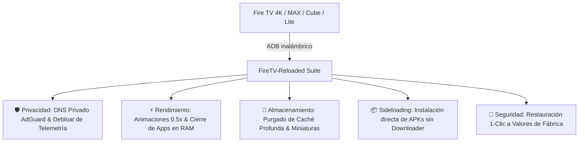

# 🚀 FireTV-Reloaded Suite

<div align="center">


**Suite automatizada de ingeniería y optimización extrema para dispositivos Amazon Fire TV.**  
*Eliminación de telemetría, bloqueo de publicidad por DNS, aceleración al 200% del mando, purga profunda de caché y sideloading directo de APKs sin Downloader.*

</div>

---

## 📖 Descripción del Proyecto

**FireTV-Reloaded** nace de la necesidad de devolver la fluidez, el control y la privacidad a los dispositivos multimedia de Amazon. Con las actualizaciones sucesivas de Fire OS, los dispositivos acumulan servicios en segundo plano de telemetría de compras, sincronizaciones analíticas pesadas y banners publicitarios invasivos que degradan la experiencia de uso.

Desarrollada y calibrada con el asistente avanzado de código **Google Antigravity** y modelos **Gemini**, esta suite proporciona una solución profesional, no destructiva y 100% reversible para gestionar, optimizar y aprovisionar cualquier dispositivo Fire TV desde una computadora Windows en la misma red local.

---

## 🌟 Características Principales



1. **🛡️ Bloqueo Integral de Publicidad y Telemetría:**
   - Inyección de **Private DNS** a nivel global (`dns.adguard-dns.com`) para filtrar publicidad en streaming y dominios de rastreo.
   - Desactivación selectiva mediante `pm disable-user --user 0` de servicios comerciales y analíticos de Amazon (`shopping.myx`, `tahoe`, `sale.service`, etc.).
   - **Preservación total de la pantalla de inicio oficial** (`com.amazon.tv.launcher`) sin romper dependencias.

2. **⚡ Aceleración de la Interfaz y Control Remoto:**
   - Reducción de las escalas de animación de ventana, transición y animador de `1.0x` a `0.5x`.
   - Respuesta instantánea al mando a distancia eliminando el retraso característico de navegación.

3. **🧹 Liberación Extrema de RAM y Almacenamiento:**
   - **Cierre Forzado de Procesos:** Cierre masivo de aplicaciones pesadas en segundo plano con retorno al Home limpio.
   - **Limpieza Profunda de Caché:** Ejecución de `pm trim-caches` y eliminación de archivos residuales (`.thumbnails`, buffers) **sin borrar cuentas ni inicios de sesión**.
   - *Caso real probado:* Recuperación de más de **1.4 GB de almacenamiento libre** en Fire TV Stick 4K MAX.

4. **📦 Sideloading Directo (Sin Downloader):**
   - Transfiere e instala cualquier aplicación `.apk` directamente por red local en segundos.
   - Olvídate de abrir *Downloader*, escribir códigos numéricos o navegar entre anuncios engañosos en el televisor.

5. **🔄 Reversibilidad al 100% (Safety Net):**
   - Cada acción genera un registro. Un solo script de rescate (`99_restore_all.ps1`) reactiva todos los servicios y restablece los valores de fábrica en caso de ser necesario.

---

## 🎯 Dispositivos Compatibles

| Dispositivo | Versión de Fire OS | Base Android | Estado |
| :--- | :---: | :---: | :---: |
| **Fire TV Stick Lite** | Fire OS 7 | Android 9 | ✅ Compatible |
| **Fire TV Stick 4K (1ª Gen)** | Fire OS 6 | Android 7.1 | ✅ Compatible |
| **Fire TV Stick 4K (2ª Gen)** | Fire OS 8 | Android 11 | ✅ Compatible |
| **Fire TV Stick 4K MAX (1ª Gen)** | Fire OS 7 | Android 9 | ✅ Compatible |
| **Fire TV Stick 4K MAX (2ª Gen)** | Fire OS 8 | Android 11 | ✅ Compatible |
| **Fire TV Cube (2ª y 3ª Gen)** | Fire OS 7 | Android 9 | ✅ Compatible |

---

## 📁 Arquitectura del Repositorio

```text
amazon-firetv/
├── apks/                     # Directorio para colocar archivos .apk a instalar
├── scripts/
│   ├── 01_connect.ps1        # Conexión remota por IP y autorización RSA
│   ├── 02_audit_packages.ps1 # Auditoría y volcado de paquetes del dispositivo
│   ├── 03_debloat_safe.ps1   # Congelamiento seguro de telemetría y anuncios
│   ├── 04_dns_adblock.ps1    # Configuración de DNS Privado Anti-Publicidad
│   ├── 05_install_apk.ps1    # Instalador directo de APKs por red
│   ├── 06_optimize_ui.ps1    # Aceleración de animaciones a 0.5x
│   ├── 07_uninstall_custom_apps.ps1 # Desinstalador limpio de apps solicitadas
│   ├── 08_close_background_apps.ps1 # Cierre forzado de procesos en segundo plano
│   ├── 09_deep_cache_cleanup.ps1    # Limpieza profunda de cachés y miniaturas
│   └── 99_restore_all.ps1    # Protocolo de reversión y restauración total
├── tools/                    # Binarios portables oficiales de Android Platform-Tools
├── firetv_manager.bat        # Panel de control visual interactivo de 1-clic
├── setup_tools.ps1           # Descargador automático de ADB oficial de Google
├── sync_suite.ps1            # Sincronizador de la suite con la Skill de Antigravity
├── llms.txt                  # Contexto y directrices de arquitectura para LLMs
└── README.md                 # Documentación técnica del proyecto
```

---

## 🚀 Guía de Inicio Rápido

### 1. Requisitos Previos en tu Fire TV:
1. Ve a **Configuración** ⚙️ > **Mi Fire TV** > **Acerca de**.
2. Pulsa el botón central de tu mando **7 veces sobre el nombre del dispositivo** hasta ver el mensaje *"Ya eres desarrollador"*.
3. Regresa a **Opciones para desarrolladores** y activa:
   - **Depuración ADB:** `ACTIVADO`
   - **Instalar apps desconocidas:** `ACTIVADO`
4. En **Configuración** > **Mi Fire TV** > **Acerca de** > **Red**, anota la **Dirección IP** de tu Fire TV.

> [!NOTE]
> La computadora y el Fire TV deben estar conectados a la **misma red local** para permitir la comunicación por ADB.

### 2. Ejecución con Menú Interactivo (1-Clic):
Simplemente ejecuta el lanzador:
```cmd
firetv_manager.bat
```
Selecciona la opción deseada en el menú numérico (del 1 al 12) para conectar, optimizar, limpiar o instalar aplicaciones automáticamente.

### 3. Ejecución Directa por PowerShell:
```powershell
# Descargar herramientas ADB si no existen
powershell -ExecutionPolicy Bypass -File setup_tools.ps1

# Conectar al Fire TV
powershell -ExecutionPolicy Bypass -File scripts/01_connect.ps1 -FireTvIp "10.10.10.28"

# Optimización completa de 1-Clic
powershell -ExecutionPolicy Bypass -File scripts/03_debloat_safe.ps1
powershell -ExecutionPolicy Bypass -File scripts/04_dns_adblock.ps1
powershell -ExecutionPolicy Bypass -File scripts/06_optimize_ui.ps1
powershell -ExecutionPolicy Bypass -File scripts/08_close_background_apps.ps1
powershell -ExecutionPolicy Bypass -File scripts/09_deep_cache_cleanup.ps1
```

---

## 🤖 Integración con Google Antigravity & Agentic Skills

Este proyecto incorpora una Skill oficial para agentes de inteligencia artificial llamada **`firetv-reloaded`**, lo que permite que cualquier asistente compatible con el entorno Antigravity pueda operar, mantener y escalar la optimización de los dispositivos del hogar de manera autónoma y consistente.

---

## 📄 Licencia

Este proyecto se distribuye bajo la licencia **MIT**. Puedes usarlo, modificarlo y compartirlo libremente.

---

<div align="center">
Desarrollado con ❤️ por <b>Roger R. Carvajal</b> | Impulsado por <b>Google Antigravity & Gemini</b>
</div>
